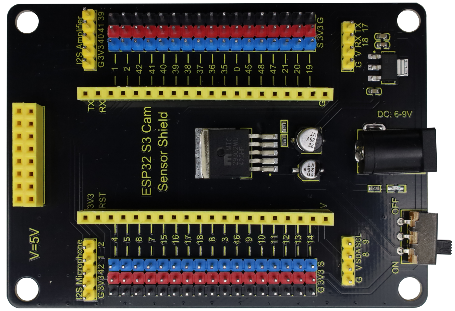
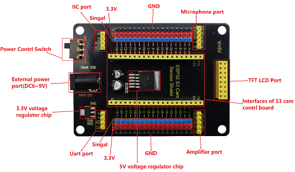
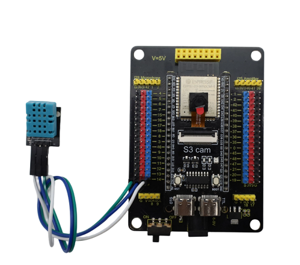
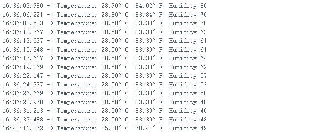

# MD2001 ESP32 S3 Cam AI Sensor Shield - Pin Header



## 1. Introduction

The ESP32 S3 Cam AI Sensor Shield reserves 2.54mm pins for S3 cam development board, as well as interfaces including IIC, serial ports, 1.54-inch colorful display. It can be powered by DC 6~9V, with a DIP switch controlling its power ON/OFF. There are also four M4 positioning holes on it which is totally compatible with Lego parts.

## 2. Specifications

- Operating voltage: DC 6~9V

- Operating current: 60mA (average)

- Max output current: 5V/2A

- Operating temperature: -25℃~+65℃

- Dimensions: 88mm\*64mm\*15mm

- Weight: 35.8g

## 3. Pin-out



## 4. Wiring
<span style="color: rgb(0, 209, 0);">**The user manual of S3 cam development board: [MB0184](https://docs.keyestudio.com/projects/MB0184/en/latest/)**</span>

| S3 cam shield | XHT11 |
| :--: | :--: |
| G | GND |
| 3V3 | 3V3 |
| 14 | S |



## 5. Arduino

For how to download and use Arduino IDE (with CH340 driver installation), please visit:  [Arduino IDE](https://www.keyesrobot.cn/projects/Arduino/zh-cn/latest/docs/ESP32%E4%B8%BB%E6%9D%BF.html)

### Downloads

* [Download the library file here](./library/Bonezegei_DHT11.zip)

```c++
#include <Bonezegei_DHT11.h>

Bonezegei_DHT11 dht(14);

void setup() {
  Serial.begin(115200);
  dht.begin();
}

void loop() {

  if (dht.getData()) {                         // get All data from DHT11
    float tempDeg = dht.getTemperature();      // return temperature in celsius
    float tempFar = dht.getTemperature(true);  // return temperature in fahrenheit if true celsius of false
    int hum = dht.getHumidity();               // return humidity
    String str  = "Temperature: ";
           str += tempDeg;
           str += "°C  ";
           str += tempFar;
           str += "°F  Humidity:";
           str += hum;
    Serial.println(str.c_str());
    //Serial.printf("Temperature: %0.1lf°C  %0.1lf°F Humidity:%d \n", tempDeg, tempFar, hum);
  }
  delay(2000);  //delay atleast 2 seconds for DHT11 to read tha data
}

```
**Test Result**



## 6. Don'ts

1. Do not directly connect high-power modules or motors to the IO expansion port;
2. Do not connect voltages higher than DC 9V to the External power port.
